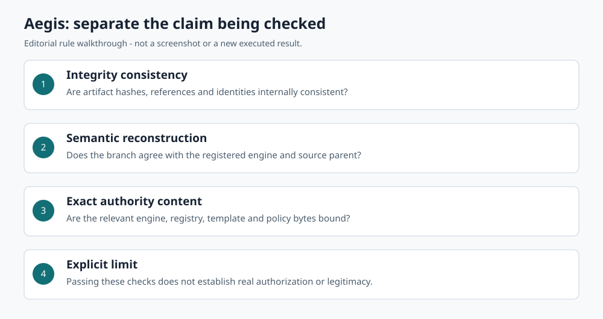

# Lux Eligarden | AI systems design work samples

Selected AI-assisted work in problem formulation, system boundaries, governance, and evaluation design. Prepared for employment and scoped collaboration discussions with AI teams.

**Start with [the flagship case study](case-studies/01-aegis.md) or the [six-page review packet](review/Mythcore_AI_Review_Packet.pdf).**

## Three work samples

| Work sample | What to assess | Evidence boundary |
|---|---|---|
| **Aegis: verifying meaning as well as bytes** | Decomposition of integrity, semantic reconstruction and exact authority-content checks; explicit limits on what verification means. | Existing bounded code and historical reports. Overall validation is blocked; not deployable as a public pilot or production service. |
| [Orchestrator: authorization and completion](case-studies/02-orchestrator.md) | Distinct decision, permit, reservation and durable-completion responsibilities. | Local implementation evidence; incomplete acceptance and coverage gates. |
| [Mirror AI: alternatives without reification](case-studies/03-mirror-ai.md) | Source-linked interpretation, uncertainty and a boundary between a candidate explanation and a fact. | Fixture-based relational reference; no demonstrated interpretation accuracy or live model integration. |

## Read in ten minutes

1. [Mechanism walkthrough](walkthroughs/aegis-denial-and-tamper.md): a documented counterfactual denial and a self-consistent forgery.
2. [Evidence and maturity](EVIDENCE_AND_MATURITY.md): implemented, source-tested, blocked and conceptual work separated.
3. [Contribution and AI assistance](CONTRIBUTIONS.md): design direction and decision work; no claim of independent code authorship.
4. [Proposed evaluation](EVALUATION_PLAN.md) and [internal critical review](INTERNAL_CRITICAL_REVIEW.md).

Selected source snapshots are included in `sources/`, so the case studies do not require access to the private preservation repositories. Code files are inspection excerpts from existing packages, not a complete runnable distribution. [Source manifest](SOURCE_MANIFEST.json) records source commits, archive members, hashes and transformations.

This portfolio demonstrates documented design reasoning and evidence discipline. It does not claim novel AI algorithms, independently validated research, a shipped product or production engineering readiness. Diagrams are explanatory illustrations, not screenshots of deployed software.

**Status: ready for Lux's review. External sharing remains subject to owner review, rights review and recipient-specific access.** No collaborators have been invited and no deployment or public release is part of this portfolio.

[Rights and notices](RIGHTS_AND_NOTICES.md) · [Preparation checklist](internal/PREPARATION_CHECKLIST.md)

