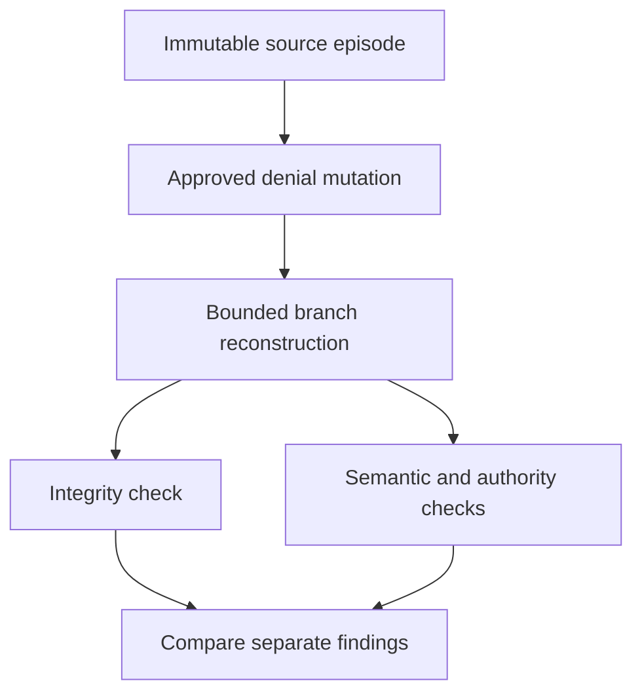

# Aegis | Denial and self-consistent tampering

**Read-only mechanism walkthrough.** Inputs and expected outputs below are drawn from included source fixtures and historical reports. No new execution took place for this portfolio. The diagram is an editorial explanation, not a software screenshot.

| Frame | Source-grounded input/action | Expected or historically recorded result | Boundary |
|---|---|---|---|
| 1 | Select CEE-001 and `lab-004-reviewer-denies`. | The parent episode remains unchanged. | No new institutional event is claimed. |
| 2 | Approved mutation: `governance.review_outcome = deny`. | Authorization absent; permit/execution blocked; completion withheld. | Denial rationale is unspecified; do not invent one. |
| 3 | Reconstruct with registered engine and exact authority content. | Stored branch report records semantic conformance passed. | Agreement with the engine, not empirical truth. |
| 4 | Alter one modeled outcome and recompute internal artifact consistency. | Historical forgery report records integrity passed but semantic/composite failed for nine variants. | Illustrates why self-consistency is insufficient; not an independent security audit. |
| 5 | Read the result as separate findings. | A failed or unavailable semantic result cannot be replaced with 'verified' based on hashes alone. | No real authorization or execution is issued. |

The report's digests identify the existing source artifacts. They are not signatures of institutional approval. The selected source's readiness flags remain false even when a branch verification passes.

Sources: [template](../sources/aegis/data/lab_templates/lab-004-reviewer-denies.json), [conformance record](../sources/aegis/reports/branch-semantic-conformance-report.json), [forgery record](../sources/aegis/reports/semantic-forgery-test-report.json).
